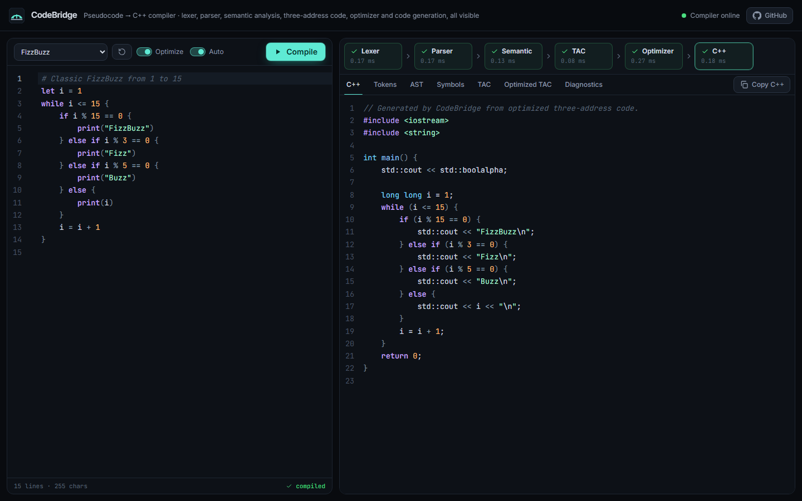
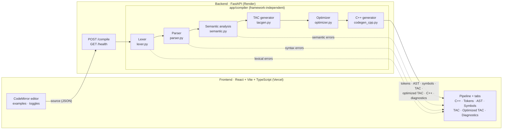
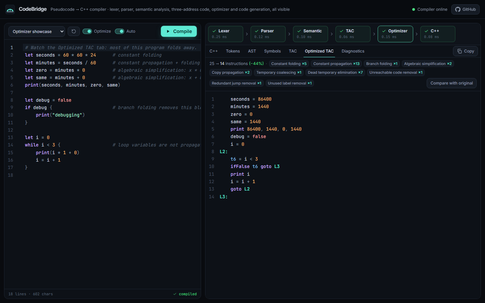
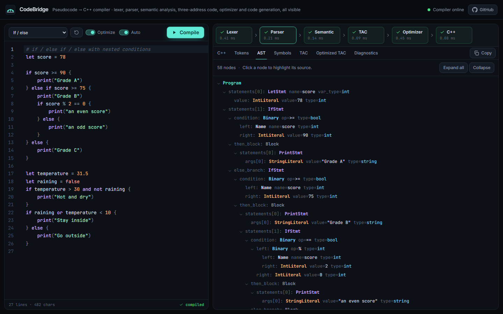
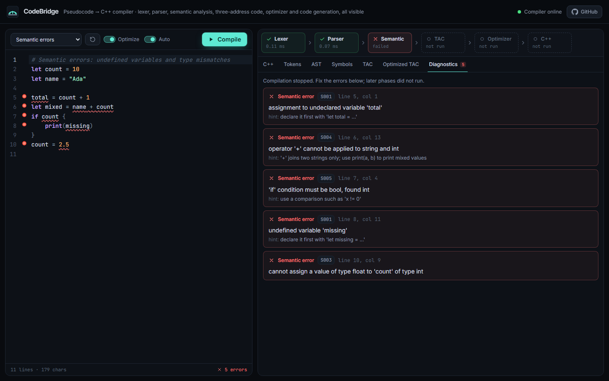
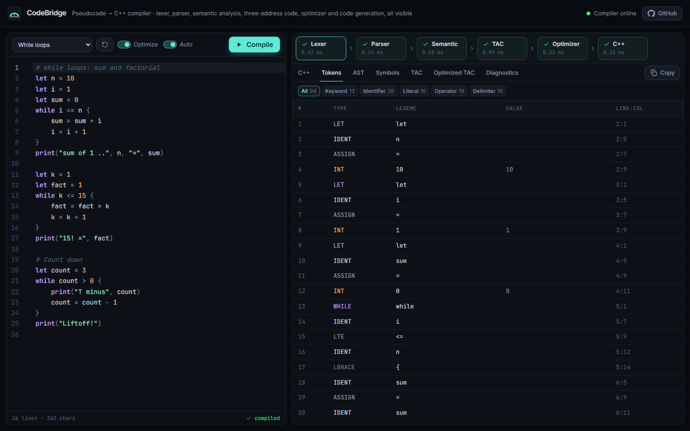
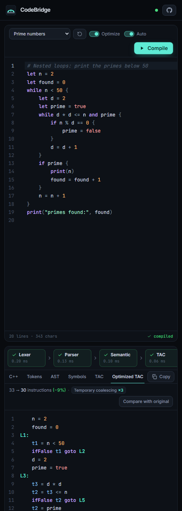

# CodeBridge

**A web-based compiler that translates a small pseudocode language into C++ and shows every compiler phase along the way.**

You write a program in the browser. CodeBridge then runs it through a hand-written compiler pipeline: lexer → recursive-descent parser → typed AST → semantic analysis → three-address code → optimizer → C++ code generator. The workbench shows the tokens, syntax tree, symbol table, original and optimized TAC, and the generated C++ for the code in the editor. Errors come back as structured diagnostics that point to a line and column.

CodeBridge is a third-year B.Tech **Compiler Design** mini-project. All phases are implemented by hand in Python, with no parser generators or existing transpilers.



---

## Contents

- [Problem statement](#problem-statement)
- [Features](#features)
- [The language](#the-language)
- [Architecture](#architecture)
- [Compiler phases](#compiler-phases)
- [Optimization examples](#optimization-examples)
- [Project structure](#project-structure)
- [Setup and running locally](#setup-and-running-locally)
- [Testing](#testing)
- [API](#api)
- [Environment variables](#environment-variables)
- [Deployment](#deployment)
- [Limitations](#limitations)
- [Screenshots](#screenshots)

## Problem statement

Students usually meet compiler phases one at a time and on paper. They rarely get to watch a single program flow through every phase of a real, working compiler. CodeBridge makes that flow visible and interactive:
- Each phase is a separate, tested module with a well-defined input and output.
- The optimizer is shown in action next to the original code.
- The final C++ output is real, compilable code. Generated programs are built with g++ in the test suite, and their output is compared with a reference interpreter.

## Features

- **Hand-written lexer:** tracks line and column positions and reports invalid characters, malformed numbers, out-of-range literals and bad string escapes.
- **Recursive-descent parser:** implements a documented EBNF grammar with correct operator precedence and associativity, `else if` chains and structured syntax errors.
- **Typed AST:** has a JSON serializer and an interactive tree view. Clicking a node highlights its source.
- **Semantic analysis:**
  - a scoped symbol table, with shadowing and unique renaming
  - type inference and checking for `int`, `float`, `string` and `bool`
  - int→float widening
  - boolean conditions
  - detection of division by a literal zero
  - unused-variable warnings
  - no cascading error messages
- **Three-address code:** uses temporaries, labels, `ifFalse`/`ifTrue`/`goto`, explicit int→float conversions and **short-circuit** `and`/`or`.
- **Optimizer:**
  - local constant and copy propagation
  - safe constant folding (C++ integer semantics, with no folding of overflow or division by zero)
  - algebraic simplification
  - branch folding
  - temporary coalescing
  - dead-temporary elimination
  - unreachable-code, jump and label cleanup
- **C++17 generator:** works from the optimized TAC. It rebuilds expressions and recovers `if`/`else if`/`while` structure, and emits correct types, string escaping and parenthesization.
- **FastAPI backend:** `POST /compile` and `GET /health`, with input validation, size limits, JSON errors and CORS configured from environment variables.
- **React workbench:**
  - CodeMirror editor with syntax highlighting, inline error underlines and Ctrl/⌘+Enter to compile
  - 12 example programs (including 3 broken ones) with a reset button
  - optimize and auto-compile toggles
  - a live phase pipeline
  - tabs for C++, tokens, AST, symbols, TAC, optimized TAC (with pass statistics and side-by-side comparison) and diagnostics
  - copy buttons
  - responsive mobile layout
- **Testing:**
  - 213 backend tests, including a 300-program randomized differential test of the optimizer
  - g++ build-and-run checks for every example
  - an end-to-end HTTP test against a live Uvicorn server
  - 20 frontend tests

The backend never executes user code. CodeBridge translates and displays C++; it does not run it.

## The language

The full specification is in **[docs/LANGUAGE.md](docs/LANGUAGE.md)**.

```text
# Comments start with '#'
let count = 10                 # type inferred: int
let price: float = 19          # explicit type; int widens to float
let name = "Ada"

while count > 0 {
    if count % 2 == 0 {
        print("even", count)
    } else if count == 5 {
        print("five")
    } else {
        print("odd")
    }
    count = count - 1
}
print(name + "!", price * 2, not (count > 0))
```

### Grammar (EBNF)

```ebnf
program     = { sep } { statement { sep } } EOF ;          (* sep = NEWLINE | ";" *)
statement   = let_stmt | assign_stmt | print_stmt | if_stmt | while_stmt ;
let_stmt    = "let" IDENT [ ":" type ] "=" expression ;
assign_stmt = IDENT "=" expression ;
print_stmt  = "print" "(" [ args ] ")" | "print" args ;
args        = expression { "," expression } ;
if_stmt     = "if" expression block [ "else" ( if_stmt | block ) ] ;
while_stmt  = "while" expression block ;
block       = "{" { sep } { statement { sep } } "}" ;
type        = "int" | "float" | "string" | "bool" ;

expression  = or_expr ;
or_expr     = and_expr { "or" and_expr } ;
and_expr    = not_expr { "and" not_expr } ;
not_expr    = "not" not_expr | equality ;
equality    = comparison { ( "==" | "!=" ) comparison } ;
comparison  = additive { ( "<" | "<=" | ">" | ">=" ) additive } ;
additive    = term { ( "+" | "-" ) term } ;
term        = unary { ( "*" | "/" | "%" ) unary } ;
unary       = "-" unary | primary ;
primary     = INT | FLOAT | STRING | "true" | "false" | IDENT | "(" expression ")" ;
```

### Supported and unsupported syntax

| Supported | Not supported (rejected with a diagnostic) |
|---|---|
| `let` declarations with optional type annotation | functions / procedures |
| assignment `x = expr` | `for`, `break`, `continue` |
| `int`, `float`, `string`, `bool` literals | arrays, lists, string indexing |
| `+ - * / %`, unary `-`, parentheses | `+=`, `++`, casts |
| `== != < <= > >=` | `&&`, `\|\|`, `!` (use `and`, `or`, `not`) |
| `and`, `or` (short-circuit), `not` | input / reading values |
| `print(a, b, ...)`, or without parentheses: `print a, b` | single-quoted strings, characters |
| `if` / `else if` / `else`, `while` (nestable) | free-standing `{ }` blocks |
| `#` comments, newline or `;` statement ends | expressions as statements |

Semantics follow C++ on purpose:
- Integer division truncates toward zero.
- The result of `%` takes the sign of the dividend.
- `int` is 64-bit.
- `print` formats floats like `std::cout`.

As a result, the generated program prints exactly what the source program means.

## Architecture



Each phase stops the pipeline when it reports errors. The response marks every phase as `ok`, `error` or `skipped`, and a failed compilation never returns TAC or C++.

## Compiler phases

### 1. Lexical analysis (`lexer.py`, `tokens.py`)

The lexer is a single-pass, hand-written scanner. It recognizes:
- keywords and identifiers (`[A-Za-z][A-Za-z0-9_]*`)
- integer, float and string literals, with escapes decoded
- operators, using a longest match first (`<=` before `<`)
- delimiters

Every token carries a 1-based line/column span. Newlines are emitted as statement terminators, except inside parentheses. The lexer keeps going after an error, so it reports **all** lexical errors at once:
- invalid characters, with hints such as "use 'not' for logical negation" for `!`
- malformed numbers (`1.2.3`, `12abc`, `3.`)
- out-of-range literals
- unterminated strings and unknown escapes

### 2. Syntax analysis (`parser.py`, `ast_nodes.py`)

The parser is a recursive-descent parser with one function per grammar rule.
- **Precedence** comes from the call hierarchy: `or` → `and` → `not` → equality → comparison → additive → term → unary → primary.
- **Left associativity** comes from loops (`while next is '+': left = Binary(left, op, right)`).

The parser builds typed dataclass nodes (`LetStmt`, `IfStmt`, `Binary`, …) with source spans. It stops at the first syntax error and returns a structured diagnostic such as "expected ')' to close '(' but found '{'". Nesting depth and expression size are bounded, so pathological input cannot exhaust the Python stack.

### 3. Semantic analysis (`semantic.py`, `typesys.py`)

A **symbol table** keeps a stack of scopes, one per block. Analysis walks the AST and does three things:
- **Resolves names.** Undefined variables, assignments to undeclared variables and redeclarations in the same scope are errors. Shadowing in an inner block is allowed, and the shadowing variable gets a unique name (`x_2`) that later phases use. Names are also kept clear of C++ keywords and of TAC temporaries.
- **Infers and checks types.** It annotates every expression with its type and enforces the type rules from the spec: only int→float widens implicitly, conditions must be `bool`, `%` needs ints, `+` works on numbers or two strings, and so on.
- **Reports all errors**, with no cascades. A variable whose initializer failed is "poisoned" so that its later uses don't add a misleading "undefined variable" error. Unused variables produce a warning.

### 4. Intermediate code: Three Address Code (`tac.py`, `tacgen.py`)

The typed AST is lowered to TAC. Each instruction has at most one operator:

| Instruction | Form |
|---|---|
| Copy | `x = y` |
| Binary | `t1 = a + b` |
| Unary | `t2 = -a`, `t3 = not c`, `t4 = (float) i` |
| Jumps | `goto L1`, `ifFalse t1 goto L2`, `ifTrue t1 goto L3` |
| Label | `L1:` |
| Output | `print a, b` |

The lowering patterns are:
- **if/else:** `ifFalse c goto Lelse; …then…; goto Lend; Lelse: …else…; Lend:`
- **while:** `Lstart: …cond…; ifFalse c goto Lend; …body…; goto Lstart; Lend:`
- **and / or:** jumps that skip the right operand. This is real short-circuit evaluation, so `d != 0 and 10 / d > 1` never divides by zero.
- **Mixed int/float arithmetic:** an explicit `(float)` conversion instruction.

### 5. Optimization (`optimizer.py`)

The passes are repeated until nothing changes (a fixed point):

| Pass | What it does | Safety rule |
|---|---|---|
| Constant folding | `t1 = 2 * 3` → `t1 = 6` | Uses C++ semantics. Never folds overflow, division by zero or non-finite floats |
| Constant & copy propagation | replaces uses of `x` by its known value | Only inside a basic block. Everything is forgotten at every label (loop head or branch join) and on reassignment |
| Algebraic simplification | `x+0`, `x*1`, `x/1`, `x-0`, `x*0` (ints), `s+""` | Float rules are limited to identities that are exact in IEEE-754. `x + 0.0` is kept because `-0.0 + 0.0 = +0.0` |
| Branch folding | `ifFalse true …` disappears, `ifFalse false goto L` → `goto L` | Conditions have no side effects |
| Temporary coalescing | `t = a + b; x = t` → `x = a + b` | Only for temporaries defined and used exactly once |
| Dead temporary elimination | removes temporaries that are never read | User variables and `print`s are never removed |
| Unreachable code / jump / label cleanup | CFG reachability, `goto` to the next label, unused labels | Iterated to a fixed point |

The optimizer's correctness is **tested, not assumed**:
- Every example, plus 300 randomly generated programs, is run through a reference AST interpreter, an interpreter for the original TAC and an interpreter for the optimized TAC. All three outputs must match.

### 6. Code generation (`codegen_cpp.py`)

C++ is generated **only from the optimized TAC**, so the output reflects the optimizations. The generator works in three steps:

1. **Expression rebuilding.** A temporary that is defined once and used once is folded back into the expression that uses it. This gives `total = total + i * 5;` instead of three statements.
2. **Structuring.** The label/jump patterns from step 4 are recognized and turned back into `while`, `if`/`else` and `else if` chains. If a pattern ever fails to match, the generator emits equivalent `goto` code instead of guessing.
3. **Emission:**
   - `long long`, `double`, `std::string` and `bool` declarations. A variable first assigned at the top level is declared there; all others are declared at the top of `main`.
   - Precedence-aware parentheses and correct string escaping.
   - `std::cout` with `std::boolalpha`, with adjacent literal text merged.

## Optimization examples

Source:

```text
let x = 2 * 3 + 4
let i = 0
while i < x {
    if i % 2 == 0 and i > 0 {
        print(i)
    }
    i = i + 1
}
```

<table>
<tr><th>Original TAC</th><th>Optimized TAC</th></tr>
<tr><td>

```text
    t1 = 2 * 3
    t2 = t1 + 4
    x = t2
    i = 0
L1:
    t3 = i < x
    ifFalse t3 goto L2
    t5 = i % 2
    t4 = t5 == 0
    ifFalse t4 goto L3
    t4 = i > 0
L3:
    ifFalse t4 goto L4
    print i
L4:
    t8 = i + 1
    i = t8
    goto L1
L2:
```

</td><td>

```text
    x = 10
    i = 0
L1:
    t3 = i < x
    ifFalse t3 goto L2
    t5 = i % 2
    t4 = t5 == 0
    ifFalse t4 goto L3
    t4 = i > 0
L3:
    ifFalse t4 goto L4
    print i
L4:
    i = i + 1
    goto L1
L2:
```

</td></tr>
</table>

The optimizer applied these passes:
- 2 × constant folding
- 2 × constant propagation
- 1 × temporary coalescing
- 2 × dead-temporary elimination

`i < x` is deliberately **not** rewritten to `i < 10`. `L1` is a loop header, so propagation stops there, which keeps the optimizer safe when variables change inside loops.

Generated C++:

```cpp
int main() {
    std::cout << std::boolalpha;

    bool t4 = false;

    long long x = 10;
    long long i = 0;
    while (i < x) {
        t4 = i % 2 == 0;
        if (t4) {
            t4 = i > 0;
        }
        if (t4) {
            std::cout << i << "\n";
        }
        i = i + 1;
    }
    return 0;
}
```

The `examples/optimization.cb` sample shows branch folding and algebraic simplification. In the workbench, open **Optimized TAC → Compare with original**.

## Project structure

```
CodeBridge/
├── backend/
│   ├── app/
│   │   ├── main.py              FastAPI app: /health, /compile, CORS, error handling
│   │   ├── config.py            environment configuration
│   │   ├── schemas.py           Pydantic request/response models
│   │   └── compiler/
│   │       ├── tokens.py        token types, keyword and operator tables
│   │       ├── lexer.py         lexical analysis
│   │       ├── ast_nodes.py     typed AST and JSON serializer
│   │       ├── parser.py        recursive-descent parser (grammar in docstring)
│   │       ├── typesys.py       types and C++ type mapping
│   │       ├── semantic.py      symbol table, scopes, type checking
│   │       ├── tac.py           TAC instruction set
│   │       ├── tacgen.py        AST → TAC
│   │       ├── semantics.py     C++-compatible value semantics (folding)
│   │       ├── optimizer.py     optimization passes
│   │       ├── codegen_cpp.py   optimized TAC → C++
│   │       ├── diagnostics.py   spans and structured diagnostics
│   │       └── pipeline.py      compile_source(): runs all phases
│   ├── tests/                   pytest suites + reference interpreters and g++ harness
│   ├── requirements.txt         runtime deps (FastAPI, Uvicorn, Pydantic)
│   ├── requirements-dev.txt     + pytest, httpx2
│   └── .env.example
├── frontend/
│   ├── src/
│   │   ├── App.tsx              workbench state and layout
│   │   ├── components/          header, pipeline, editor panel, output tabs, views
│   │   ├── editor/              CodeMirror setup, language modes, theme
│   │   └── lib/                 API client, examples, phase helpers, hooks
│   ├── package.json
│   └── .env.example
├── examples/                    *.cb programs, index.json, expected/*.txt outputs
├── docs/
│   ├── LANGUAGE.md              language specification
│   ├── TEST_MATRIX.md           what is tested and where
│   ├── REPORT.md                mini-project report
│   ├── SLIDES.md                presentation slide content
│   └── screenshots/
├── render.yaml                  Render blueprint (backend)
├── vercel.json                  Vercel config (frontend)
└── .github/workflows/ci.yml     CI: backend + frontend tests and build
```

## Setup and running locally

You need:
- Python 3.13
- Node.js 22+
- optionally, g++ or clang++ to run the C++ build-and-run tests

**Backend**

```powershell
cd backend
py -3.13 -m venv .venv                  # once
.venv\Scripts\python.exe -m pip install -r requirements-dev.txt
.venv\Scripts\python.exe -m uvicorn app.main:app --reload --port 8000
```

On macOS/Linux, use `python3.13 -m venv .venv` and `.venv/bin/python`.

**Frontend**

```powershell
cd frontend
npm install
npm run dev                              # http://localhost:5173
```

The frontend calls `http://localhost:8000` in development by default. To point it elsewhere, set `VITE_API_URL` in `frontend/.env.local`.

## Testing

```powershell
cd backend;  .venv\Scripts\python.exe -m pytest      # 213 tests
cd frontend; npm run typecheck; npm test; npm run build   # 20 tests + type check + build
```

The backend suite includes:
- unit tests for every phase
- API tests for success and for lexical, syntax and semantic errors, plus validation and size limits
- optimizer equivalence checks (examples + 300 random programs)
- g++ compilation of the generated C++ for every example, compared with the expected output in `examples/expected/`
- an end-to-end test that starts a real Uvicorn server and compiles over HTTP

The C++ tests find the compiler from `CODEBRIDGE_CXX`, then `g++` or `clang++` on PATH, then `C:\msys64\ucrt64\bin\g++.exe`. If no compiler is found, they are **skipped** (not faked).

See [docs/TEST_MATRIX.md](docs/TEST_MATRIX.md) for the full matrix. GitHub Actions runs both suites on every push.

## API

### `GET /health`

```json
{ "status": "ok", "service": "codebridge", "version": "1.0.0" }
```

### `POST /compile`

Request:

```json
{ "source": "let x = 2 + 3\nprint(x * 2)", "optimize": true }
```

The response is always HTTP 200 for a well-formed request, whether or not the program compiles. This is a real, abridged response:

```json
{
  "success": true,
  "phases": [{ "name": "lexer", "status": "ok" }, "… parser, semantic, tac, optimizer, codegen"],
  "diagnostics": [],
  "tokens": [{ "type": "LET", "category": "keyword", "lexeme": "let", "line": 1, "column": 1, "end_line": 1, "end_column": 4, "value": null }, "…"],
  "ast": { "kind": "Program", "statements": ["…"], "span": { "line": 1, "column": 1, "end_line": 2, "end_column": 13 } },
  "symbols": [{ "name": "x", "unique_name": "x", "type": "int", "scope_depth": 0, "line": 1, "column": 5, "used": true }],
  "tac": ["    t1 = 2 + 3", "    x = t1", "    t2 = x * 2", "    print t2"],
  "optimized_tac": ["    x = 5", "    print 10"],
  "optimization": {
    "rounds": 2,
    "passes": { "constant_folding": 2, "constant_propagation": 3, "dead_temp_elimination": 2 },
    "labels": { "constant_folding": "Constant folding", "…": "…" },
    "instructions_before": 4,
    "instructions_after": 2
  },
  "cpp": "// Generated by CodeBridge …",
  "structured_cpp": true,
  "timings_ms": { "lexer": 0.12, "parser": 0.086, "semantic": 0.078, "tac": 0.037, "optimizer": 0.158, "codegen": 0.065 }
}
```

When compilation fails, `success` is `false`:
- The failing phase has status `error` and later phases are `skipped`.
- `diagnostics` lists the errors. Each one has `stage` (`lexical`/`syntax`/`semantic`), `code`, `message`, `line`, `column`, end position and `notes`.
- `tac`, `optimized_tac` and `cpp` are `null`.

Other error responses:
- `422`: malformed requests.
- `413`: source over the size limit.
- `500`: unexpected server errors, as JSON with no stack trace.

## Environment variables

| Where | Variable | Default | Purpose |
|---|---|---|---|
| backend | `CORS_ORIGINS` | `http://localhost:5173,http://127.0.0.1:5173` | Comma-separated origins allowed to call the API |
| backend | `MAX_SOURCE_CHARS` | `20000` | Maximum source size accepted by `/compile` |
| backend (Render) | `PYTHON_VERSION` | `3.13.15` (in `render.yaml`) | Python runtime on Render |
| frontend | `VITE_API_URL` | `http://localhost:8000` in dev | API base URL. **Required** for production builds |

No secrets are needed. `.env` files are git-ignored, and only the `.env.example` files are committed.

## Deployment

The setup is a **backend on Render** and a **frontend on Vercel**. Both configs are in the repository.

1. **Render (API):**
   - Go to *New → Blueprint* and select this repository. Render reads `render.yaml`, which uses rootDir `backend`, `pip install -r requirements.txt` and `uvicorn app.main:app --host 0.0.0.0 --port $PORT`, with a health check on `/health`.
   - Set `CORS_ORIGINS` to the Vercel URL, for example `https://codebridge.vercel.app`.
2. **Vercel (frontend):**
   - Import the repository and keep the root directory as the repository root. `vercel.json` builds `frontend/`, so the shared `examples/` folder is available.
   - Set `VITE_API_URL` to the Render URL, for example `https://codebridge-api.onrender.com`.
3. Redeploy the frontend after setting the variable, because Vite inlines it at build time. Then check:
   - `GET <render-url>/health` returns `ok`.
   - The deployed workbench compiles the starter program.

On Render's free plan the service sleeps when idle. The first request can take up to about a minute, and the UI shows a "waking up the compiler server" message while it waits.

**Live URLs:** see [CLAUDE.md § Deployment](CLAUDE.md#7-deployment) for the current status.

## Limitations

- **Missing language features:** there are no functions, arrays, `for`/`break`/`continue` or input. The language is intentionally small.
- **Syntax errors:** the parser reports the **first** syntax error only. It does no error recovery. Lexical and semantic errors are all reported.
- **Optimizer scope:** propagation is **local to basic blocks**. There is no global data-flow analysis, so loop-invariant values (such as `x` in `while i < x`) are not propagated, and loop-invariant code motion is not implemented.
- **Runtime errors:** dividing by a variable that is zero at run time, and integer overflow, are undefined behavior, exactly as in C++. CodeBridge detects only literal division by zero.
- **Float output:** floats print with C++'s default 6 significant digits.
- **No execution:** the backend translates code but never compiles or runs it. Execution is out of scope by design.

## Screenshots

| Optimized TAC with pass statistics | AST viewer |
|---|---|
|  |  |
| **Semantic diagnostics** | **Token stream** |
|  |  |

<p align="center"></p>
