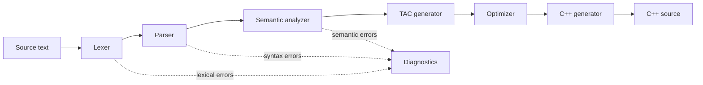

# CodeBridge: A Pseudocode-to-C++ Compiler with a Phase-by-Phase Workbench

*Compiler Design mini-project report (B.Tech, third year)*

Fill in before submitting:
- Student name(s) and roll number(s)
- Guide
- Department, institution and academic year

---

## Abstract

CodeBridge is a compiler that translates a small, statically typed pseudocode language into C++17. It is built from scratch in Python. Its phases are lexical analysis, recursive-descent parsing into a typed abstract syntax tree, semantic analysis with a scoped symbol table and type checker, generation of Three Address Code (TAC), machine-independent optimization and C++ code generation.

The compiler is exposed through a FastAPI web service and a React workbench. The workbench shows the output of every phase for the program being edited: tokens, AST, symbol table, original and optimized TAC, generated C++ and structured diagnostics.

Correctness is checked by 213 automated backend tests:
- the generated C++ for every example program is compiled with g++ and its output compared with a reference interpreter;
- the optimizer is checked against 300 randomly generated programs.

## 1. Introduction

### 1.1 Motivation

Compiler phases are usually taught in isolation. Students rarely see one program pass through a complete, working compiler, or watch how an optimizer changes intermediate code. CodeBridge makes this visible and interactive.

### 1.2 Objectives

1. Design a small but complete language: variables, the types int, float, string and bool, arithmetic, comparisons, logical operators, `print`, `if`/`else` and `while`.
2. Implement every compiler phase by hand, with no lexer or parser generators.
3. Report lexical, syntax and semantic errors with exact line and column positions.
4. Generate Three Address Code and apply safe optimizations.
5. Generate C++ that compiles and behaves exactly like the source program.
6. Present all phases in a responsive web interface.

### 1.3 Scope

**In scope:** everything described in this report.

**Out of scope, by design:**
- functions, arrays, `for` loops and input;
- running user programs on the server.

## 2. Language design

The language specification is in `docs/LANGUAGE.md`.

**Syntax.** Statements end with a newline or `;`, and blocks use braces. The parser is predictive and mostly needs one token of lookahead. It uses a second token in three places:
- after an identifier, to check for `=`;
- to allow `else` on the line after `}`;
- to allow `{` on the line after a condition.

**Type system.**
- Types are static and inferred from initializers. Optional annotations are allowed (`let x: float = 1`).
- The only implicit conversion is int → float.
- Conditions must be `bool`.

**Semantics follow C++.** These choices make translation faithful:
- integers are 64-bit;
- `/` truncates toward zero, and `%` takes the sign of the dividend;
- `and` and `or` short-circuit;
- floats print in `std::cout` format.

Example:

```text
let n = 2
while n < 20 {
    let d = 2
    let prime = true
    while d * d <= n and prime {
        if n % d == 0 { prime = false }
        d = d + 1
    }
    if prime { print(n) }
    n = n + 1
}
```

## 3. System architecture



- **Backend (Python 3.13, FastAPI).** The package `app/compiler` contains one module per phase and has no web dependencies. `pipeline.compile_source()` runs the phases, times them and stops at the first phase that reports errors. `POST /compile` returns every artifact plus a status for each phase.
- **Frontend (React, TypeScript, Vite, Tailwind CSS, CodeMirror 6).** It provides:
  - a source editor with highlighting and inline error markers;
  - an example selector;
  - a pipeline view;
  - tabs for each artifact.

  Everything it displays comes from the API response for the current source.

## 4. Implementation of the compiler phases

### 4.1 Lexical analysis

The lexer is a hand-written scanner over the character stream (`lexer.py`).

- **Token classes:** keywords, identifiers, int, float and string literals, operators and delimiters (`tokens.py`).
- **Operators:** matched longest first (`<=` before `<`, `==` before `=`).
- **Newlines:** become `NEWLINE` tokens that terminate statements. While the parenthesis depth is above zero they are suppressed, so expressions can span lines.
- **Positions:** each token records a 1-based span (line, column, end line, end column).
- **Error handling:** the lexer reports the error and keeps going, so all lexical errors are found in one pass:
  - invalid characters, with hints;
  - malformed numbers such as `1.2.3` or `12abc`;
  - integers outside 64 bits and non-finite floats;
  - unterminated strings and unknown escapes.

### 4.2 Syntax analysis

The parser (`parser.py`) is a **recursive-descent parser** with one method per non-terminal.

- **Precedence** comes from the chain of grammar levels: `or` < `and` < `not` < equality < comparison < additive < multiplicative < unary.
- **Left associativity** comes from iteration rather than recursion inside each level.
- **AST:** the parser builds typed dataclass nodes (`ast_nodes.py`). Each node carries a source span, and a serializer converts the tree to JSON for the frontend.
- **Errors:** the parser stops at the first syntax error and raises a structured diagnostic, for example "expected ')' to close '(' but found '{'".
- **Limits:** nesting depth (50) and expression height (150) are bounded, so hostile input cannot overflow the Python call stack.

### 4.3 Semantic analysis

The analyzer (`semantic.py`) walks the AST with a **symbol table** implemented as a stack of scopes, one per block.

**Name resolution:**
- It reports undefined variables (S001) and redeclaration in the same scope (S002).
- Shadowing in an inner block is allowed.
- Every declaration gets a unique name (`x`, `x_2`, …) that later phases use. These names avoid C++ keywords and the TAC temporary names `tN`.

**Type checking:**
- It infers the type of every expression.
- It checks initializer and assignment compatibility (S003), operand types (S004), `bool` conditions (S005) and division by a literal zero (S006).

**Error recovery:**
- All semantic errors are collected rather than stopping at the first.
- A variable whose initializer is invalid is marked so that its later uses produce no cascading errors.
- Unused variables produce warnings (S100).

### 4.4 Intermediate code generation (TAC)

`tacgen.py` lowers the annotated AST into typed three-address instructions:

| Form | Example |
|---|---|
| Copy | `x = t1` |
| Binary | `t1 = a * b` |
| Unary | `t2 = -a`, `t3 = not c`, `t4 = (float) i` |
| Unconditional jump | `goto L1` |
| Conditional jump | `ifFalse t1 goto L2`, `ifTrue t1 goto L3` |
| Label | `L1:` |
| Output | `print a, b` |

Control flow uses the standard schemes:
- `if`: `ifFalse c goto Lelse … goto Lend … Lelse: … Lend:`
- `while`: `Lstart: … ifFalse c goto Lend … goto Lstart; Lend:`

`and` and `or` are compiled with jumps, so they short-circuit. For example, `d != 0 and 10 / d > 1` never divides by zero.

Mixed int/float operations get an explicit `(float)` conversion.

### 4.5 Code optimization

`optimizer.py` repeats the following passes until nothing changes:

1. **Local constant and copy propagation, with constant folding and algebraic simplification, within basic blocks.**
   - Known values are discarded at every label, which is where control-flow paths merge. This keeps loops and branches safe.
   - A value is also discarded when a variable it depends on is reassigned.
   - Folding uses C++ semantics (`semantics.py`). It refuses overflow, division by zero and non-finite float results.
   - Floating-point identities are restricted to those exact under IEEE-754. For example, `x + 0.0` is *not* simplified, because `-0.0 + 0.0 = +0.0`.
2. **Branch folding.** A conditional jump on a constant becomes a `goto` or is removed.
3. **Temporary coalescing** (peephole). `t = a + b; x = t` becomes `x = a + b` when `t` is used once.
4. **Dead temporary elimination.** User variables and `print`s are never removed.
5. **Control-flow cleanup.** This removes code that is unreachable in the control-flow graph, jumps to the immediately following label and unused labels.

*Example:* the source `let x = 2 * 3 + 4` produces this TAC:

```text
t1 = 2 * 3
t2 = t1 + 4
x = t2
```

After optimization it is a single instruction:

```text
x = 10
```

In the "optimization" sample program, the instruction count drops from 25 to 14 (−44%).

### 4.6 Code generation

`codegen_cpp.py` translates the **optimized** TAC into C++17 in three steps:

1. **Expression rebuilding.** Temporaries that are used once are folded back into their use site.
2. **Structuring.** The jump patterns of §4.4 are recognized and turned back into `while`, `if`/`else` and `else if`. A `goto`-based fallback guarantees correct output even if a pattern does not match.
3. **Emission.**
   - Type mapping: int → `long long`, float → `double`, string → `std::string`, bool → `bool`.
   - Declarations are placed at the first top-level assignment, or hoisted to the top of `main`.
   - Parentheses follow operator precedence.
   - String literals are escaped.
   - Output uses `std::cout` with `std::boolalpha`.

## 5. User interface

The workbench has two panes.

**Editor pane:**
- an example selector, reset button, optimize and auto-compile toggles and a Compile button (Ctrl/⌘+Enter);
- a CodeMirror editor with CodeBridge syntax highlighting, line numbers and wavy underlines at the error positions reported by the compiler.

**Output pane:**
- A **pipeline strip** shows each phase's status (ok, failed or not run) and its time in milliseconds.
- **Tabs** show:
  - the generated C++;
  - a filterable token table;
  - a collapsible AST tree (clicking a node selects its source text);
  - the symbol table, including renamed symbols;
  - the TAC;
  - the optimized TAC, with per-pass statistics and a side-by-side comparison;
  - the diagnostics list.

The pane also handles these states:
- loading, empty and connection errors;
- stale results, when the source has changed since the last compile;
- a "waking the server" message for hosting cold starts.

The layout is responsive down to phone widths.

## 6. Testing and results

The full matrix is in `docs/TEST_MATRIX.md`.

| Suite | Tests | Result |
|---|---:|---|
| Lexer | 12 | pass |
| Parser and AST | 48 | pass |
| Semantic analysis | 31 | pass |
| TAC generation | 18 | pass |
| Optimizer, including 300-program differential test | 28 | pass |
| C++ generation, including g++ build and run | 36 | pass |
| API and health | 34 | pass |
| End-to-end (live server → HTTP → g++) | 6 | pass |
| Frontend (Vitest) | 20 | pass |

Each example program is run four ways, and the outputs must match exactly:
1. the reference AST interpreter;
2. an interpreter for the original TAC;
3. an interpreter for the optimized TAC;
4. a native binary built from the generated C++ with g++.

A 20,000-character program compiles in about 0.1 s.

## 7. Limitations and future work

**Limitations:**
- The parser reports only the first syntax error. Panic-mode recovery could report more.
- Propagation is local to basic blocks. Global data-flow analysis (reaching definitions, live variables) would enable loop-invariant code motion and global constant propagation.
- There are no functions, arrays, `for` loops or input.
- Runtime division by zero and integer overflow behave as in C++ (undefined behavior).

**Future work:**
- functions with a call stack in TAC;
- SSA form;
- register allocation for a real target;
- in-browser execution of the generated C++ through WebAssembly.

## 8. Conclusion

CodeBridge implements a complete compiler pipeline for a small language and makes each phase observable. Testing the optimizer and code generator against independent reference interpreters, and against real g++ binaries, gives strong evidence that the translation is correct.

## References

1. A. V. Aho, M. S. Lam, R. Sethi, J. D. Ullman. *Compilers: Principles, Techniques, and Tools*, 2nd ed. Pearson, 2006.
2. R. Nystrom. *Crafting Interpreters*. Genever Benning, 2021.
3. K. D. Cooper, L. Torczon. *Engineering a Compiler*, 2nd ed. Morgan Kaufmann, 2011.
4. ISO/IEC 14882:2017, *Programming languages — C++*.
